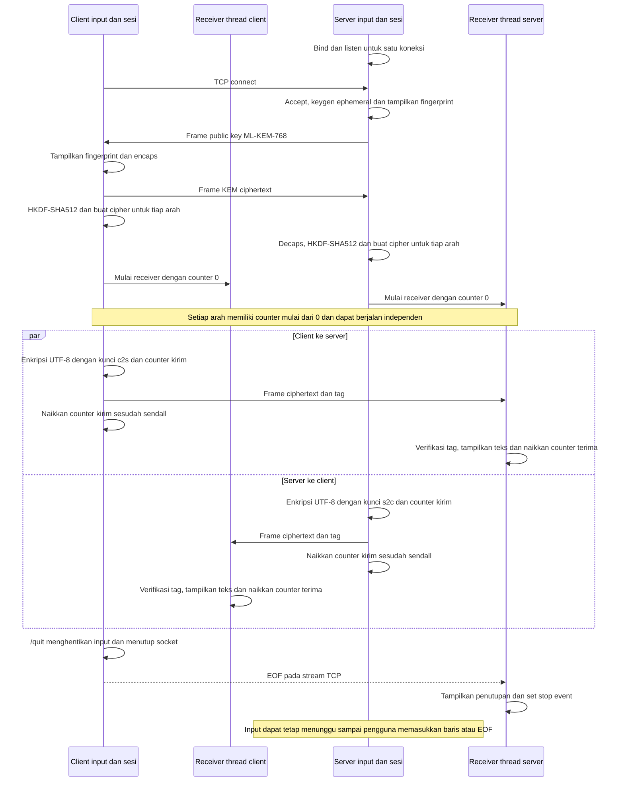

# Arsitektur prototipe HPQC — Stage 02

Prototipe membuka satu koneksi TCP untuk dua arah chat teks. Kedua endpoint bertukar material ML-KEM-768 menggunakan dua frame. Setelah itu kedua arah dapat mengirim dan menerima pesan AES-256-GCM secara independen.

## Pemisahan modul

| Sebelum | Modul sesudah refactor | Alasan |
|---|---|---|
| `main()` mengurai mode sekaligus mengelola kedua socket di `chat.py` | `chat.py` meneruskan perintah lama. `server.py` mengelola bind, listen, accept. `client.py` mengelola connect dan timeout. | Kedua siklus hidup socket bisa dibaca dan dijalankan sendiri. Kedua mode tetap berbagi satu implementasi sesi. |
| Opsi host/port, connect timeout dan batas frame tersebar di `chat.py` | `config.py` | Default bersama tersimpan di satu tempat. |
| `recv_exact()`, `send_frame()`, dan `recv_frame()` ada bersama chat | `protocol/transport.py` | Framing dan pembacaan TCP parsial dapat diuji independen dari kriptografi. |
| `handle()` mengimpor dan memanggil ML-KEM secara langsung | `crypto_engine/kem.py` meneruskan `keygen`, `encaps`, dan `decaps` dari `pqcrypto.kem.ml_kem_768` | Satu titik akses ke implementasi library dengan signature asli. |
| `keys_from_secret()` berada di `chat.py` | `crypto_engine/kdf.py` | Parameter derivasi dan urutan dua kunci dapat diuji terpisah. |
| `handle()` dan receiver sama-sama membentuk nonce dan AAD | `crypto_engine/aead.py` dan `MessageCipher` | Satu implementasi menggunakan aturan yang sama pada encrypt dan decrypt. |
| `handle()` melakukan pertukaran KEM, derivasi dan chat | `protocol/handshake.py` mengelola dua peran handshake. `protocol/session.py` memiliki dua counter, pemetaan kunci, input, receiver thread, dan shutdown. | Batas fungsi memisahkan pembentukan kunci dari siklus pesan. |

`chat.py` juga mengekspor ulang `MAX_FRAME`, fungsi framing, `keys_from_secret()`, dan `handle()` untuk pemanggil lama.

## Sequence diagram

## Kontrak wire dan sesi

- Prefix panjang body adalah integer unsigned big-endian 4 byte. Batas body adalah 1.048.576 byte. Body kosong diterima oleh framing. Body handshake dari server adalah public key 1184 byte. Body handshake dari client adalah KEM ciphertext 1088 byte.
- HKDF-SHA512 menurunkan 64 byte dari shared secret dengan `salt=None` dan `info=b"HPQC-LAB-v1 ML-KEM-768 AES-256-GCM"`. 32 byte pertama dipakai untuk c2s dan 32 byte berikutnya untuk s2c.
- Body pesan adalah ciphertext diikuti tag 16 byte. Panjang plaintext UTF-8 maksimum 1.048.560 byte. Nonce adalah counter arah dalam 12 byte big-endian. AAD ialah `b"HPQC-LAB-v1:" + direction + sequence.to_bytes(8, "big")` dengan direction berupa `b"c2s"` atau `b"s2c"`. Kedua endpoint menghitung nonce dan AAD secara lokal.
- Server menerima satu koneksi. Client memakai timeout 10 detik untuk connect lalu beralih ke blocking I/O. Fingerprint dipakai untuk perbandingan manual. Protokol asli mengakhiri sesi dengan penutupan socket.
