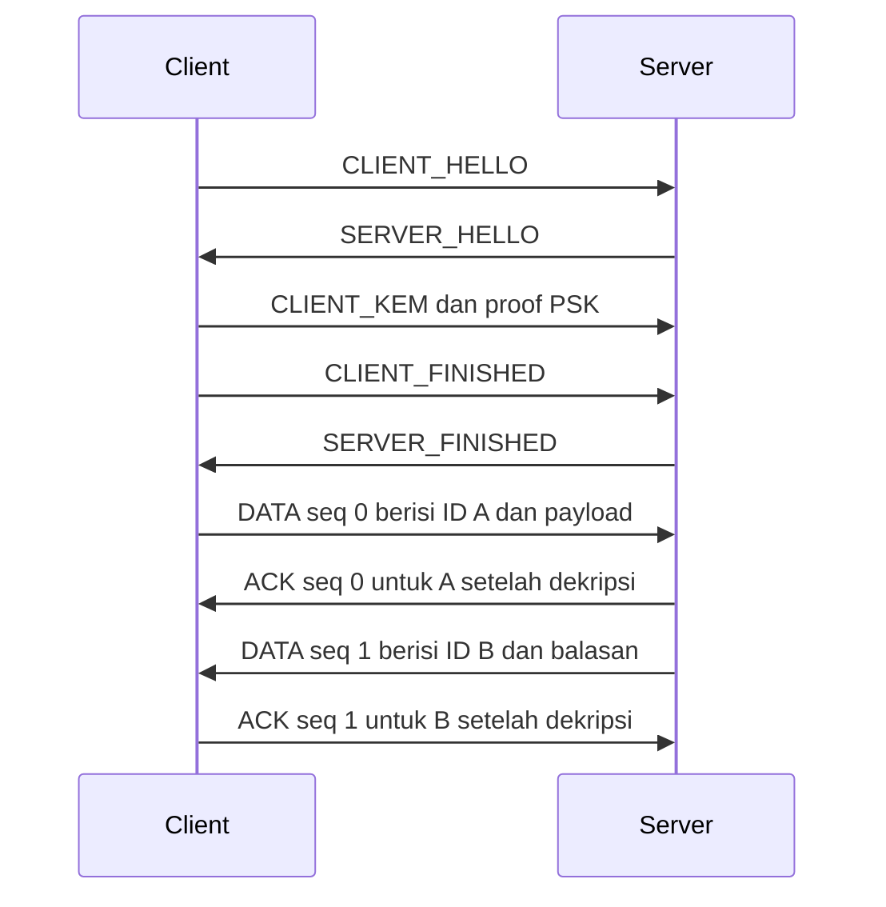

# Stage 05 — transfer DATA dan ACK

Satu koneksi TCP menjalankan [handshake v2](secure_handshake.md) terlebih dahulu. Setelah endpoint memverifikasi Finished sesuai perannya, `DataChannel` membuat dua `DirectionCipher` dari [Crypto Engine](crypto_engine.md). Cipher kirim dan terima masing-masing memiliki directional key, riwayat nonce, dan sequence sendiri. Keduanya dipakai sepanjang sesi.

## Format record

Semua integer memakai network byte order. Prefix 4 byte menyatakan ukuran body, yaitu header + ciphertext + tag. Tabel menunjukkan offset relatif terhadap awal **header**, tepat sesudah prefix.

| Offset | Field | Byte | Isi |
|---:|---|---:|---|
| 0 | version | 1 | 2 |
| 1 | message type | 1 | DATA = 0x10, ACK = 0x11 |
| 2 | suite | 1 | ID suite pada sesi terkonfirmasi, default 1. [Daftar ID Stage 07](crypto_agility.md) |
| 3 | session ID | 16 | Nilai publik dari handshake yang dikonfirmasi |
| 19 | direction | 1 | 0 client ke server, 1 server ke client |
| 20 | sequence | 8 | Mulai dari 0 untuk setiap arah. DATA dan ACK memakai urutan yang sama dalam arah tersebut. |
| 28 | nonce | 12 | Dihasilkan CSPRNG dan dilacak per kunci |
| 40 | ciphertext length | 4 | Jumlah byte ciphertext sebelum tag |

Encoding `!BBB16sBQ12sI` menghasilkan 44 byte. Seluruh byte header menjadi AAD AES-256-GCM. Ciphertext diikuti tag 16 byte. Penerima membatasi body hingga 2 MiB sebelum membaca header, memeriksa konteks, tipe, sequence dan kesesuaian kedua panjang sebelum membaca ciphertext, lalu memverifikasi tag.

| Record | Plaintext terenkripsi | Ukuran pada stream TCP |
|---|---|---:|
| DATA | message ID acak 16 byte diikuti payload aplikasi 0–1.048.576 byte | panjang payload + 80 byte |
| ACK | message ID 16 byte milik DATA yang diterima | 80 byte |

Overhead tetap record adalah **64 byte** (4 + 44 + 16). Metadata message ID menambah 16 byte. Untuk payload 1 MiB, satu DATA memakai 1.048.656 byte, diikuti ACK 80 byte ke arah sebaliknya. Perhitungan ini mengecualikan handshake dan overhead TCP/IP.

## Pengiriman dan validasi

1. `send_data(payload: bytes) -> bytes` memilih message ID dengan `secrets.token_bytes(16)`. Pemanggil memperoleh ID sesudah frame terkirim. ID dicatat sebagai pesan yang masih menunggu ACK. Satu DATA dapat menunggu ACK pada tiap arah.
2. `receive()` menerima satu record. Untuk DATA, ia memeriksa tag, membuka plaintext, dan menolak message ID yang sudah diterima di sesi itu. Sesudah validasi, ia mengirim ACK terautentikasi dan mengembalikan `ReceivedData(message_id, payload)`.
3. Pada pengirim, `receive()` hanya menghasilkan `Acknowledgement(message_id)` setelah ACK lolos pemeriksaan sesi, arah, sequence, panjang, tag, dan kecocokan ID yang sedang ditunggu. ACK yang diterima tidak memicu ACK tambahan.
4. Sequence kirim maju sesudah `sendall()` berhasil. Sequence terima maju sesudah autentikasi dan validasi semantik record. Nonce duplikat, replay, tag salah, atau record malformed menutup sesi. I/O parsial yang gagal juga menutup sesi karena posisi stream selanjutnya tidak lagi pasti. Saat kuota Stage 03 habis, diperlukan koneksi dan handshake baru dengan kunci segar.

`DataChannel(sock, *, role, psk, timeout=10.0)` mengambil kepemilikan socket terhubung. Gunakan sebagai context manager. Untuk aplikasi yang mengirim serentak di kedua arah, jalankan pembaca pada kedua endpoint selama pengiriman berlangsung. Pembaca dapat menerima ACK lokal atau DATA dari peer lebih dahulu. Satu lock kirim mengurutkan DATA dan ACK pada wire. CLI contoh menggunakan urutan client mengirim, server menerima dan membalas.



## Menjalankan di Windows, Ubuntu, atau Debian

Dari root proyek, aktifkan venv yang mempunyai dependency dari requirements.txt. Sediakan PSK biner 32 byte yang sama di kedua endpoint sesuai [panduan provisioning](secure_handshake.md). Nama `stage04.psk` di bawah merujuk ke file lokal tersebut. Buat file uji 1 MiB sekali di sisi client:

```text
python -c "with open('uji-1MiB.bin', 'xb') as f: f.write(bytes(range(256)) * 4096)"
```

Pada terminal server:

```text
python -B -m protocol.transfer_cli server --host 127.0.0.1 --port 5050 --psk-file stage04.psk --text "Berkas diterima" --output hasil-server.bin
```

Pada terminal client:

```text
python -B -m protocol.transfer_cli client --host 127.0.0.1 --port 5050 --psk-file stage04.psk --input uji-1MiB.bin --output balasan.txt
```

Untuk uji antar-VM, ganti alamat loopback pada kedua perintah dengan IP adapter lab Debian. Jalankan server di Debian dan client di Ubuntu. Bandingkan SHA-256 file input client dengan file output server memakai `Get-FileHash -Algorithm SHA256` pada PowerShell atau `sha256sum` pada Linux. Baca balasan.txt sebagai UTF-8. Untuk pengulangan, gunakan nama output baru karena CLI membuat file secara eksklusif.

CLI mengirim satu payload per endpoint melalui `--input` atau `--text`. Tanpa `--output`, payload diterima di memori. Baris status menampilkan message ID dan jumlah byte. **ACK menyatakan penerimaan dan validasi di memori.** Penulisan file keluaran terjadi sesudah ACK. Jika koneksi putus sebelum pengirim memverifikasi ACK, status delivery di sisi pengirim belum terkonfirmasi. Opsi `--timeout` mengatur deadline handshake. Record berikutnya mewarisi pengaturan timeout socket. Deduplikasi lintas sesi dan pemulihan koneksi merupakan pekerjaan tahap resilience.

## Menguji

```text
python -B -m unittest discover -s tests -p test_data_v2.py -v
python -B -m unittest discover -s tests -v
python -B smoke_test.py
```

Tes Stage 05 mencocokkan byte wire dengan dekripsi AES-GCM menggunakan seluruh header sebagai AAD. Tes juga memeriksa payload kedua arah, penerimaan ACK, pembacaan terfragmentasi, dan penolakan record yang tidak valid. Lokasi ZIP pembanding untuk regresi legacy ada di [README](../README.md). Hasil aktual dan batas lingkungan pengujian tercatat dalam [PROGRESS.md](../PROGRESS.md).
